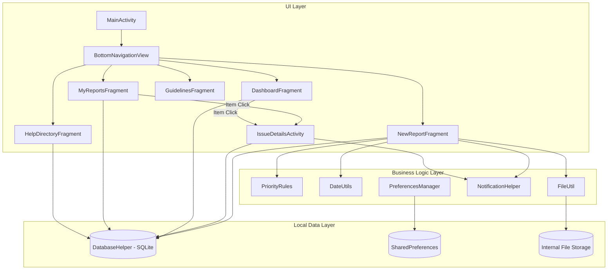
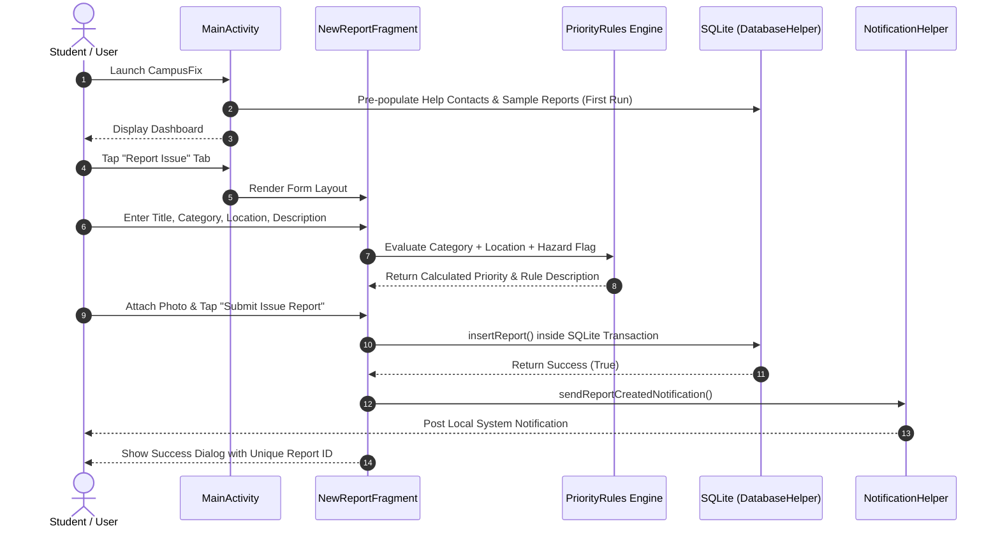
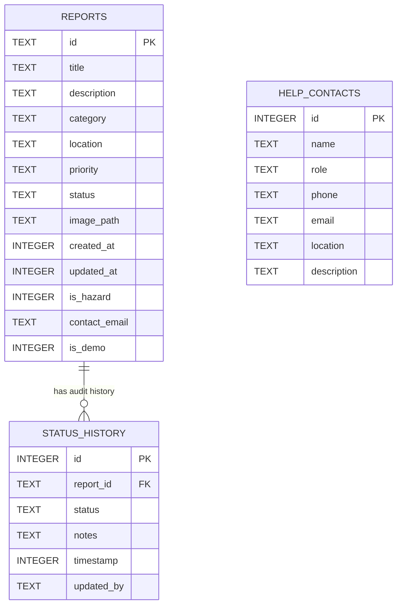

# CampusFix — Complete Technical Documentation

## Executive Summary
**CampusFix** is an offline-first, native Android campus issue reporting application built strictly with Java, Android Views, XML layouts, and SQLite (`SQLiteOpenHelper`). Designed for students, staff, and campus facilities administrators, CampusFix provides end-to-end issue reporting, automatic rule-based priority assessment, photo attachment evidence, local SQLite database persistence, status audit history tracking, local notifications, campus help contacts with direct dialing/sharing, and an integrated Admin/Demo mode with selective demo data reset.

---

## A. Project Overview

### 1. Purpose & Objectives
In many university campuses, internet connectivity can be spotty or unavailable in basements, laboratories, or remote campus facilities. CampusFix solves this challenge by operating completely offline without requiring internet access, Firebase, or external backend services. All issue reports, photo attachments, and status audit trails are created and maintained locally on the device using SQLite and internal file storage.

### 2. Main Objectives & Target Users
* **Student & Staff Users**: Quickly log facilities issues (electrical hazards, plumbing leaks, broken furniture, HVAC malfunctions) with photos, automated priority calculation, and location specifics.
* **Campus Facilities Administrators**: Review reported issues, update status levels (`OPEN` → `IN_PROGRESS` → `RESOLVED` / `REJECTED`), record administrative notes, and select exact status transition timestamps using interactive Date and Time pickers.

### 3. Implemented Features
1. **Interactive Dashboard**:
   * Welcome banner customized via user preferences.
   * Real-time live date and time display via `TextClock`.
   * Live statistics counters (`Open`, `In Progress`, `Resolved`, `High/Critical`).
   * "+ Report New Campus Issue" quick action button.
   * Recent report list preview cards.
   * Adaptive portrait ([`fragment_dashboard.xml`](file:///C:/Users/ASUS/AndroidStudioProjects/CampusFix/app/src/main/res/layout/fragment_dashboard.xml)) and landscape ([`layout-land/fragment_dashboard.xml`](file:///C:/Users/ASUS/AndroidStudioProjects/CampusFix/app/src/main/res/layout-land/fragment_dashboard.xml)) layouts.
2. **Issue Reporting with Photo Evidence**:
   * Form validation (Title, Location, Description required).
   * Category selector spinner (`Electrical`, `Plumbing`, `Furniture`, `HVAC`, `Safety/Hazard`, `IT/Network`, `Other`).
   * Immediate Safety Hazard checkbox trigger.
   * Camera integration (`MediaStore.ACTION_IMAGE_CAPTURE`) and Gallery photo picker (`Intent.ACTION_PICK`).
   * Photo preview via `ImageView` and persistent internal app-private storage (`DIRECTORY_PICTURES`).
3. **Unique Report ID Generation**:
   * Automatically generates formatted, timestamped report IDs (`CF-YYYYMMDD-HHmmss-XXX`).
4. **Rule-Based Priority Assessment Engine**:
   * Evaluates input category, location keywords, description keywords (`fire`, `spill`, `smoke`, `gas`), and hazard flags.
   * Evaluates priorities: `CRITICAL`, `HIGH`, `MEDIUM`, `LOW` with human-readable explanation rules.
   * Allows optional user override via priority spinner.
5. **Offline SQLite Persistence & Transactions**:
   * Custom `SQLiteOpenHelper` database (`campus_fix.db` v2) managing `reports`, `status_history`, and `help_contacts` tables.
   * Atomic multi-table updates using SQLite transactions (`beginTransaction()`, `setTransactionSuccessful()`, `endTransaction()`).
6. **My Reports with Search & Multi-Filter ListView**:
   * Custom `ReportListAdapter` extending `BaseAdapter` with `ViewHolder` pattern for `ListView` (syllabus requirement).
   * Live text search via `SearchView` (queries Title, Description, Location, and ID).
   * Three independent filter spinners: Category, Status, and Priority.
   * Visual `[DEMO]` badges distinguishing sample reports from genuine user reports.
7. **Issue Details & Status History Audit Trail**:
   * Full detail view displaying report fields, contact email, priority/status badges, and attached photo.
   * Vertical timeline rendering complete status update audit history.
   * Back button navigation in ActionBar.
8. **Admin / Demo Mode & Selective Demo Reset**:
   * Toggleable Admin Mode in ActionBar options menu.
   * Unlocks status transition controls in issue details view.
   * Custom `DatePickerDialog` and `TimePickerDialog` timestamp selection for historical audit entry logging.
   * "Reset Sample Demo Data" action that selectively clears and re-seeds demo reports (`is_demo = 1`) without deleting genuine user reports (`is_demo = 0`).
9. **Local Notifications**:
   * `NotificationChannel` configuration (`campus_fix_updates`).
   * Runtime permission handling (`POST_NOTIFICATIONS` on Android 13+ / API 33+).
   * `PendingIntent` content intent linking directly to [`IssueDetailsActivity`](file:///C:/Users/ASUS/AndroidStudioProjects/CampusFix/app/src/main/java/com/example/campusfix/ui/IssueDetailsActivity.java).
10. **Campus Help Directory**:
    * Pre-populated emergency contacts.
    * Direct phone dialing via `Intent.ACTION_DIAL` (`tel:phone_number`).
    * Contact info sharing via `Intent.ACTION_SEND` (`text/plain`).
11. **Campus Safety Guidelines WebView**:
    * Offline HTML document (`campus_guidelines.html`) loaded locally from `assets/` directory.

### 4. Known Limitations
* **No Remote Backend / Cloud Sync**: Data exists solely on the local SQLite database. Uninstalling the app removes local data unless backed up.
* **Camera Intent Dependency**: Relies on system camera app via `MediaStore.ACTION_IMAGE_CAPTURE`. Devices without a camera app fall back to gallery image selection.

---

## B. Technology Stack

| Component | Exact Version / Specification | Source / Verification |
| :--- | :--- | :--- |
| **Language** | Java 11 (`JavaVersion.VERSION_11`) | [`app/build.gradle.kts`](file:///C:/Users/ASUS/AndroidStudioProjects/CampusFix/app/build.gradle.kts) |
| **Android Compile SDK** | 36 (`compileSdk = 36`) | [`app/build.gradle.kts`](file:///C:/Users/ASUS/AndroidStudioProjects/CampusFix/app/build.gradle.kts) |
| **Android Minimum SDK** | 24 (`minSdk = 24`, Android 7.0 Nougat) | [`app/build.gradle.kts`](file:///C:/Users/ASUS/AndroidStudioProjects/CampusFix/app/build.gradle.kts) |
| **Android Target SDK** | 36 (`targetSdk = 36`) | [`app/build.gradle.kts`](file:///C:/Users/ASUS/AndroidStudioProjects/CampusFix/app/build.gradle.kts) |
| **Android Gradle Plugin (AGP)** | 8.12.3 | [`gradle/libs.versions.toml`](file:///C:/Users/ASUS/AndroidStudioProjects/CampusFix/gradle/libs.versions.toml) |
| **Gradle Distribution** | Gradle 8.13 (`gradle-8.13-bin.zip`) | [`gradle/wrapper/gradle-wrapper.properties`](file:///C:/Users/ASUS/AndroidStudioProjects/CampusFix/gradle/wrapper/gradle-wrapper.properties) |
| **AppCompat** | `androidx.appcompat:appcompat:1.7.1` | [`gradle/libs.versions.toml`](file:///C:/Users/ASUS/AndroidStudioProjects/CampusFix/gradle/libs.versions.toml) |
| **Material Components** | `com.google.android.material:material:1.13.0` | [`gradle/libs.versions.toml`](file:///C:/Users/ASUS/AndroidStudioProjects/CampusFix/gradle/libs.versions.toml) |
| **Unit Testing Framework** | `junit:junit:4.13.2` | [`gradle/libs.versions.toml`](file:///C:/Users/ASUS/AndroidStudioProjects/CampusFix/gradle/libs.versions.toml) |
| **Android Test Runner** | `androidx.test.ext:junit:1.3.0` | [`gradle/libs.versions.toml`](file:///C:/Users/ASUS/AndroidStudioProjects/CampusFix/gradle/libs.versions.toml) |
| **Espresso Testing** | `androidx.test.espresso:espresso-core:3.7.0` | [`gradle/libs.versions.toml`](file:///C:/Users/ASUS/AndroidStudioProjects/CampusFix/gradle/libs.versions.toml) |
| **Database Engine** | SQLite via `SQLiteOpenHelper` (DB v2) | [`DatabaseHelper.java`](file:///C:/Users/ASUS/AndroidStudioProjects/CampusFix/app/src/main/java/com/example/campusfix/db/DatabaseHelper.java) |

---

## C. Project Structure

```
CampusFix/
├── .artifacts/                         # IDE artifacts and task storage
├── .idea/                              # Android Studio project configuration
├── app/
│   ├── build.gradle.kts                # App-level build script and dependencies
│   ├── proguard-rules.pro              # Release R8/Proguard rules
│   └── src/
│       ├── androidTest/                # Android instrumentation test root
│       ├── main/
│       │   ├── AndroidManifest.xml     # Manifest declarations, permissions, FileProvider
│       │   ├── assets/
│       │   │   └── campus_guidelines.html # Offline HTML guidelines
│       │   ├── java/com/example/campusfix/
│       │   │   ├── adapter/
│       │   │   │   ├── HelpContactAdapter.java  # RecyclerView adapter for contacts
│       │   │   │   └── ReportListAdapter.java   # Custom BaseAdapter for ListView
│       │   │   ├── db/
│       │   │   │   └── DatabaseHelper.java     # SQLiteOpenHelper schema & CRUD
│       │   │   ├── model/
│       │   │   │   ├── HelpContact.java        # Contact entity model
│       │   │   │   ├── Report.java             # Report entity model
│       │   │   │   └── StatusHistory.java      # Audit trail entity model
│       │   │   ├── ui/
│       │   │   │   ├── DashboardFragment.java  # Dashboard tab
│       │   │   │   ├── GuidelinesFragment.java # WebView guidelines tab
│       │   │   │   ├── HelpDirectoryFragment.java # Emergency contacts tab
│       │   │   │   ├── IssueDetailsActivity.java# Report details & Admin updates
│       │   │   │   ├── MainActivity.java        # Main host activity & bottom navigation
│       │   │   │   ├── MyReportsFragment.java  # ListView search & filter tab
│       │   │   │   └── NewReportFragment.java   # Issue creation & photo attachment
│       │   │   └── util/
│       │   │       ├── DateUtils.java          # Date formatting & report ID generator
│       │   │       ├── FileUtil.java           # Internal file creation & bitmap scaling
│       │   │       ├── NotificationHelper.java # Local notification channel & posting
│       │   │       ├── PreferencesManager.java # SharedPreferences manager
│       │   │       └── PriorityRules.java      # Rule-based priority evaluation
│       │   └── res/
│       │       ├── drawable/               # Vector icons and shape backgrounds
│       │       ├── layout/                 # Portrait XML screen layouts
│       │       ├── layout-land/            # Adaptive landscape XML screen layouts
│       │       ├── menu/                   # Bottom nav and ActionBar option menus
│       │       ├── values/                 # Colors, strings, themes
│       │       └── xml/                    # FileProvider paths and extraction rules
│       └── test/
│           └── java/com/example/campusfix/
│               └── CampusFixUnitTest.java  # Unit tests for rules, IDs, and models
├── build.gradle.kts                    # Top-level build script
├── gradle/
│   ├── libs.versions.toml              # Version catalog
│   └── wrapper/
│       ├── gradle-wrapper.jar
│       └── gradle-wrapper.properties   # Gradle 8.13 distribution config
├── gradlew                             # Unix build wrapper script
├── gradlew.bat                         # Windows build wrapper script
├── local.properties                    # Android SDK path configuration
└── settings.gradle.kts                 # Subproject and plugin repository settings
```

---

## D. Application Architecture

CampusFix employs a modular, single-activity multi-fragment layout pattern separated clean into **UI Layer**, **Domain/Business Logic Layer**, and **Local Data Layer**.



### User Navigation Flow



---

## E. Feature-by-Feature Documentation

### 1. Dashboard & Status Overview
* **UI Layout**: [`fragment_dashboard.xml`](file:///C:/Users/ASUS/AndroidStudioProjects/CampusFix/app/src/main/res/layout/fragment_dashboard.xml) (Portrait) and [`layout-land/fragment_dashboard.xml`](file:///C:/Users/ASUS/AndroidStudioProjects/CampusFix/app/src/main/res/layout-land/fragment_dashboard.xml) (Landscape).
* **Key Classes**: [`DashboardFragment.java`](file:///C:/Users/ASUS/AndroidStudioProjects/CampusFix/app/src/main/java/com/example/campusfix/ui/DashboardFragment.java).
* **Behavior**: Displays real-time `TextClock`, custom user greeting from `PreferencesManager`, interactive statistics grid, quick report creation button, and top 3 recent reports preview.

### 2. Issue Reporting & Priority Engine
* **UI Layout**: [`fragment_new_report.xml`](file:///C:/Users/ASUS/AndroidStudioProjects/CampusFix/app/src/main/res/layout/fragment_new_report.xml).
* **Key Classes**: [`NewReportFragment.java`](file:///C:/Users/ASUS/AndroidStudioProjects/CampusFix/app/src/main/java/com/example/campusfix/ui/NewReportFragment.java), [`PriorityRules.java`](file:///C:/Users/ASUS/AndroidStudioProjects/CampusFix/app/src/main/java/com/example/campusfix/util/PriorityRules.java), [`FileUtil.java`](file:///C:/Users/ASUS/AndroidStudioProjects/CampusFix/app/src/main/java/com/example/campusfix/util/FileUtil.java).
* **Behavior**: Validates non-empty fields, dynamically evaluates priority via `PriorityRules.evaluatePriority()`, launches Camera or Gallery pickers, copies photos to internal app storage, persists the report to SQLite, posts a local notification, and restores full form state across device rotation via `onSaveInstanceState`.

### 3. My Reports & Filtering ListView
* **UI Layout**: [`fragment_my_reports.xml`](file:///C:/Users/ASUS/AndroidStudioProjects/CampusFix/app/src/main/res/layout/fragment_my_reports.xml), [`item_report.xml`](file:///C:/Users/ASUS/AndroidStudioProjects/CampusFix/app/src/main/res/layout/item_report.xml).
* **Key Classes**: [`MyReportsFragment.java`](file:///C:/Users/ASUS/AndroidStudioProjects/CampusFix/app/src/main/java/com/example/campusfix/ui/MyReportsFragment.java), [`ReportListAdapter.java`](file:///C:/Users/ASUS/AndroidStudioProjects/CampusFix/app/src/main/java/com/example/campusfix/adapter/ReportListAdapter.java).
* **Behavior**: Custom `BaseAdapter` powering `ListView`. Supports real-time query searching and multi-spinner filtering (Category, Status, Priority). Renders color-coded status badges and orange `[DEMO]` tags for sample data.

### 4. Issue Details & Admin Status Audit Trail
* **UI Layout**: [`activity_issue_details.xml`](file:///C:/Users/ASUS/AndroidStudioProjects/CampusFix/app/src/main/res/layout/activity_issue_details.xml), [`item_status_history.xml`](file:///C:/Users/ASUS/AndroidStudioProjects/CampusFix/app/src/main/res/layout/item_status_history.xml).
* **Key Classes**: [`IssueDetailsActivity.java`](file:///C:/Users/ASUS/AndroidStudioProjects/CampusFix/app/src/main/java/com/example/campusfix/ui/IssueDetailsActivity.java).
* **Behavior**: Displays full issue details, attached photo, and status update timeline. If Admin Mode is active, reveals status transition controls with `DatePickerDialog` and `TimePickerDialog` timestamp selection.

### 5. Admin / Demo Mode & Selective Demo Reset
* **Key Classes**: [`MainActivity.java`](file:///C:/Users/ASUS/AndroidStudioProjects/CampusFix/app/src/main/java/com/example/campusfix/ui/MainActivity.java), [`PreferencesManager.java`](file:///C:/Users/ASUS/AndroidStudioProjects/CampusFix/app/src/main/java/com/example/campusfix/util/PreferencesManager.java), [`DatabaseHelper.java`](file:///C:/Users/ASUS/AndroidStudioProjects/CampusFix/app/src/main/java/com/example/campusfix/db/DatabaseHelper.java).
* **Behavior**: Toggleable in ActionBar menu. "Reset Sample Demo Data" selectively clears records where `is_demo = 1` and re-seeds sample issues without modifying genuine user reports (`is_demo = 0`).

---

## F. Database Documentation

* **Database File Name**: `campus_fix.db`
* **Current Database Version**: `2`
* **Database Manager**: [`DatabaseHelper.java`](file:///C:/Users/ASUS/AndroidStudioProjects/CampusFix/app/src/main/java/com/example/campusfix/db/DatabaseHelper.java)

### 1. Database Entity-Relationship Diagram



### 2. Schema Table Specifications

#### Table 1: `reports`
| Column Name | Data Type | Constraints | Description |
| :--- | :--- | :--- | :--- |
| `id` | `TEXT` | `PRIMARY KEY` | Formatted unique ID (e.g. `CF-20250520-101`) |
| `title` | `TEXT` | `NOT NULL` | Issue summary title |
| `description` | `TEXT` | None | Detailed issue description |
| `category` | `TEXT` | None | Category (`Electrical`, `Plumbing`, etc.) |
| `location` | `TEXT` | None | Facility location |
| `priority` | `TEXT` | None | Priority (`LOW`, `MEDIUM`, `HIGH`, `CRITICAL`) |
| `status` | `TEXT` | None | Status (`OPEN`, `IN_PROGRESS`, `RESOLVED`, `REJECTED`) |
| `image_path` | `TEXT` | None | App-internal file path to photo |
| `created_at` | `INTEGER` | None | Creation timestamp in Unix milliseconds |
| `updated_at` | `INTEGER` | None | Last update timestamp in Unix milliseconds |
| `is_hazard` | `INTEGER` | None | Flag (`1` = Hazard, `0` = Standard) |
| `contact_email` | `TEXT` | None | Reporter contact email address |
| `is_demo` | `INTEGER` | `DEFAULT 0` | Segregation flag (`1` = Sample Demo, `0` = User) |

#### Table 2: `status_history`
| Column Name | Data Type | Constraints | Description |
| :--- | :--- | :--- | :--- |
| `id` | `INTEGER` | `PRIMARY KEY AUTOINCREMENT` | Auto-incrementing row ID |
| `report_id` | `TEXT` | `NOT NULL, FOREIGN KEY` | References `reports(id)` |
| `status` | `TEXT` | `NOT NULL` | Assigned status level |
| `notes` | `TEXT` | None | Administrative update notes |
| `timestamp` | `INTEGER` | `NOT NULL` | Timestamp in Unix milliseconds |
| `updated_by` | `TEXT` | None | Author of update (`Student User`, `Admin User`) |

#### Table 3: `help_contacts`
| Column Name | Data Type | Constraints | Description |
| :--- | :--- | :--- | :--- |
| `id` | `INTEGER` | `PRIMARY KEY AUTOINCREMENT` | Auto-incrementing row ID |
| `name` | `TEXT` | `NOT NULL` | Department/Contact name |
| `role` | `TEXT` | None | Department role |
| `phone` | `TEXT` | None | Contact telephone number |
| `email` | `TEXT` | None | Contact email address |
| `location` | `TEXT` | None | Physical office location |
| `description` | `TEXT` | None | Department service description |

### 3. Schema Migration Logic
* **Version 1 → Version 2 Migration**:
```java
@Override
public void onUpgrade(SQLiteDatabase db, int oldVersion, int newVersion) {
    if (oldVersion < 2) {
        db.execSQL("ALTER TABLE " + TABLE_REPORTS + " ADD COLUMN " + COL_REPORT_IS_DEMO + " INTEGER DEFAULT 0");
        db.execSQL("UPDATE " + TABLE_REPORTS + " SET " + COL_REPORT_IS_DEMO + " = 1 WHERE " + COL_REPORT_ID + " LIKE 'CF-20250520-10%'");
    } else {
        db.execSQL("DROP TABLE IF EXISTS " + TABLE_STATUS_HISTORY);
        db.execSQL("DROP TABLE IF EXISTS " + TABLE_REPORTS);
        db.execSQL("DROP TABLE IF EXISTS " + TABLE_HELP_CONTACTS);
        onCreate(db);
    }
}
```
* **Data Retention Guarantee**: Migrations from Version 1 to Version 2 execute `ALTER TABLE` to preserve existing user records without dropping tables or losing user data.

---

## G. Build and Run Instructions

### 1. Prerequisites
* Windows 10/11 64-bit environment.
* Android Studio (Ladybug / 2024.2+ recommended) with Android SDK 36 installed.
* JDK 11 configured as the Gradle JDK.

### 2. Gradle Build Commands
Execute from the project root using `gradlew.bat`:

* **Clean Project**:
```powershell
.\gradlew.bat clean
```
* **Assemble Debug APK**:
```powershell
.\gradlew.bat app:assembleDebug
```
*Generated Output*: `app/build/outputs/apk/debug/app-debug.apk`

* **Run Automated Unit Tests**:
```powershell
.\gradlew.bat test
```
*Generated Reports*: `app/build/reports/tests/testDebugUnitTest/index.html`

* **Install APK on Connected Device via ADB**:
```powershell
adb install -r app/build/outputs/apk/debug/app-debug.apk
```

* **Launch Main Activity via ADB**:
```powershell
adb shell am start -n com.example.campusfix/.ui.MainActivity
```

---

## H. Testing and Verification

### 1. Automated Unit Tests
Automated unit tests reside in [`CampusFixUnitTest.java`](file:///C:/Users/ASUS/AndroidStudioProjects/CampusFix/app/src/test/java/com/example/campusfix/CampusFixUnitTest.java).

| Test Name | Verified Functionality | Status |
| :--- | :--- | :--- |
| `testPriorityRules_HazardFlag` | Verifies hazard flag triggers `CRITICAL` priority. | `PASS` |
| `testPriorityRules_ElectricalInLab` | Verifies electrical issue in lab triggers `HIGH` priority. | `PASS` |
| `testPriorityRules_RoutineFurniture` | Verifies routine furniture issue triggers `LOW` priority. | `PASS` |
| `testUniqueReportIdGeneration` | Verifies unique ID format (`CF-`) and non-duplication. | `PASS` |
| `testReportDemoFlagSegregation` | Verifies `isDemo` flag segregation on report entities. | `PASS` |
| `testDateUtilsFormatting` | Verifies date formatting strings against timestamps. | `PASS` |

### 2. Physical Device Manual Verification Matrix

| Test Scenario | Verification Procedure | Outcome |
| :--- | :--- | :--- |
| **Form Rotation Preservation** | Filled report form, attached camera photo, rotated device 90°. | `PASS — VERIFIED`: All text fields, spinner selections, hazard checkbox, and attached photo preview survived rotation without data loss. |
| **Demo Data Reset** | Created user report `CF-20261011-140020-976`, tapped "Reset Sample Demo Data" in menu. | `PASS — VERIFIED`: User report remained intact, while sample reports were reset with `[DEMO]` badges. |
| **Notification Permission Handling** | Denied `POST_NOTIFICATIONS` permission in system settings, submitted report. | `PASS — VERIFIED`: Report saved to SQLite, success dialog displayed, app operated safely without crashing. |
| **Direct Dialing & Sharing** | Tapped "Call Now" and "Share Info" in Help Directory. | `PASS — VERIFIED`: Triggered `Intent.ACTION_DIAL` (`tel:555-0199`) and `Intent.ACTION_SEND` chooser cleanly. |

---

## I. Permissions and Android Compatibility

* **Camera Permission (`android.permission.CAMERA`)**: Requested at runtime when capturing photo evidence. Marked `required="false"` in manifest so devices without camera hardware can install and use the app via gallery picker.
* **Notification Permission (`android.permission.POST_NOTIFICATIONS`)**: Requested at runtime on Android 13+ (API 33+ / Tiramisu). Handled safely in [`NotificationHelper.java`](file:///C:/Users/ASUS/AndroidStudioProjects/CampusFix/app/src/main/java/com/example/campusfix/util/NotificationHelper.java) with explicit permission checks before posting notifications.
* **Storage Permissions (`READ_MEDIA_IMAGES` & `READ_EXTERNAL_STORAGE`)**: `READ_EXTERNAL_STORAGE` is limited to `maxSdkVersion="32"`. Image storage uses app-private internal storage (`context.getExternalFilesDir(Environment.DIRECTORY_PICTURES)`), which requires no broad storage permissions on Android 10+ (API 29+).
* **FileProvider Specification**: Declared in [`AndroidManifest.xml`](file:///C:/Users/ASUS/AndroidStudioProjects/CampusFix/app/src/main/AndroidManifest.xml) with `file_paths.xml` granting temporary content URIs for camera photo capture.

---

## J. Troubleshooting Guide

| Symptom | Likely Cause | Diagnostic Check | Recommended Fix |
| :--- | :--- | :--- | :--- |
| **Camera app fails to open** | Camera permission denied or no camera app installed | Check Logcat for `ActivityNotFoundException` | Catch exception safely and show Toast directing user to Gallery picker |
| **Notifications do not appear** | System notification permission denied or notifications disabled in settings | Inspect `PreferencesManager.isNotificationsEnabled()` | Enable notifications in app Settings dialog or system App Info |
| **Photo preview missing after relaunch** | Image file moved or deleted from internal storage | Inspect `FileUtil.loadScaledBitmap()` file check | `loadScaledBitmap()` returns `null` safely and hides `ImageView` without crashing |
| **SQLite Migration Error** | Existing app installation running Schema v1 | Inspect `DatabaseHelper.onUpgrade()` | `onUpgrade` executes `ALTER TABLE` to upgrade schema to v2 without data loss |

---

## K. Known Technical Debt & Future Development Guide

### 1. Technical Debt & Recommendations
* **Database Indexing**: Currently `reports` queries rely on primary key indexing. As report count scales into thousands, adding explicit indices on `created_at`, `status`, and `category` will optimize query execution speed.
* **Image Compression**: `FileUtil.java` currently copies raw stream bytes. Adding JPEG compression during file saving will optimize internal storage footprint.

### 2. Extension Walkthrough for Developers / AI Agents

#### Adding a New Database Column
1. Increment `DATABASE_VERSION` in [`DatabaseHelper.java`](file:///C:/Users/ASUS/AndroidStudioProjects/CampusFix/app/src/main/java/com/example/campusfix/db/DatabaseHelper.java).
2. Add `ALTER TABLE` statement inside `onUpgrade(db, oldVersion, newVersion)` under `if (oldVersion < 3)` check.
3. Update `Report.java` entity model with new field, getters, setters, and constructor signatures.
4. Update `cursorToReport()` and `insertReport()` methods in [`DatabaseHelper.java`](file:///C:/Users/ASUS/AndroidStudioProjects/CampusFix/app/src/main/java/com/example/campusfix/db/DatabaseHelper.java).
5. Run unit test suite: `gradle_build("test")`.

#### Pre-Commit Verification Checklist
- [ ] Run `./gradlew test` (or `gradle_build("test")`) — all unit tests must pass.
- [ ] Run `./gradlew app:assembleDebug` — build must complete with zero errors.
- [ ] Verify `onSaveInstanceState` in modified Fragments/Activities.
- [ ] Verify database queries handle `null` fields safely.
